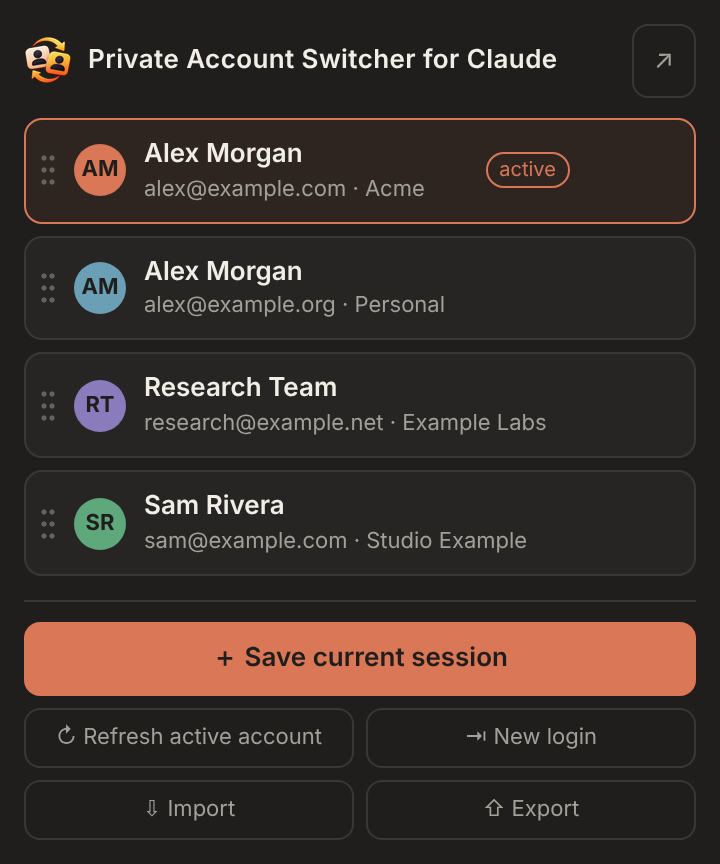

# Private Account Switcher for Claude

Browser extension (Manifest V3) to keep **several claude.ai accounts** side by side and switch between them **in one click** — no logging out and back in every time.

[](https://github.com/agteamdev/claude-switch-account/actions/workflows/build.yml)

Based on [claude-switch-account](https://github.com/Smeagolworms4/claude-switch-account) by Smeagolworms4 (MIT). Unofficial, not affiliated with Anthropic.

<p align="center">
  
</p>

---

## How it works

claude.ai authentication lives in cookies (`sessionKey` chief among them). The extension:

1. **snapshots** every `claude.ai` / `anthropic.com` cookie into a profile;
2. fetches the account **name and e-mail** from the claude.ai API to label it automatically;
3. on switching: re-saves the current session (the `sessionKey` rotates), clears the jar, restores the target profile's cookies, then reloads any open claude.ai tab.

Everything stays **local** in `chrome.storage.local`. No server, no telemetry, no passwords — only the cookies your browser already holds.

## Install

### From a release

Download the zip for your browser from [Releases](https://github.com/agteamdev/claude-switch-account/releases):

| Browser | File | How to load |
| --- | --- | --- |
| Chrome, Brave, Edge | `…-chrome.zip` | Unzip it, open `chrome://extensions` (or `brave://extensions`, `edge://extensions`), enable **Developer mode**, **Load unpacked** → the unzipped folder |
| Firefox 140+ | `…-firefox.zip` | Open `about:debugging#/runtime/this-firefox` → **Load Temporary Add-on…** → pick the zip (or the unzipped `manifest.json`); it stays until Firefox restarts |

A permanent install in regular Firefox needs a signed build, i.e. the addons.mozilla.org listing.

### From source

```bash
git clone https://github.com/agteamdev/claude-switch-account.git
cd claude-switch-account
```

Load the folder directly (**Load unpacked** in Chrome, **Load Temporary Add-on…** → `manifest.json` in Firefox). The packages are built with `bash tools/build.sh` (see [Development](#development)).

## Usage

| Action | Effect |
| --- | --- |
| **＋ Save current session** | Adds the logged-in account to the list (name + e-mail detected automatically) |
| **Click an account** | Switches to it and reloads claude.ai tabs |
| **⇥ New login** | Clears the session without deleting profiles — to add another account |
| **↻ Refresh active account** | Re-saves the active account's cookies (handy after re-authenticating) |
| **✎ / 🗑** | Rename / delete a profile |
| **Drag an account** | Reorder the list; the order is saved |
| **⇩ Import / ⇧ Export** | Export saves all accounts to a JSON file, optionally encrypted with a password; import merges such a file into the list (a session already saved is only replaced by a newer one) and asks for the password when the file is encrypted. On Firefox, Import opens in a tab |

### Adding a second account

1. Log into account A on claude.ai → **＋ Save current session**.
2. **⇥ New login** → log into account B.
3. **＋ Save current session**.
4. Both accounts now sit in the list; one click switches between them.

## Languages

UI translated through `chrome.i18n`, auto-selected from the browser language:

🇬🇧 English (default) · 🇫🇷 Français · 🇩🇪 Deutsch · 🇪🇸 Español · 🇮🇹 Italiano · 🇵🇹 Português · 🇺🇦 Українська · 🇷🇺 Русский

Adding a language = copy `_locales/en/messages.json` to `_locales/<code>/messages.json`. CI enforces that every locale carries exactly the same keys.

## Development

```
manifest.json                 # MV3, cookies/storage/tabs permissions
background.js                 # service worker: cookie snapshot / clear / restore, export / import
popup.html/.css/.js           # account list UI
_locales/<lang>/              # translations
icons/                        # extension icons
tools/build.sh                # builds dist/: Chrome and Firefox packages + sources
```

### Building

Requirements: `bash`, `zip`, `node` 18 or newer.

```bash
bash tools/build.sh
```

Output in `dist/`:

- `chrome-mv3/`, `firefox-mv3/`: unpacked builds. They differ only in `manifest.json`: Chrome gets `background.service_worker`, Firefox gets `background.scripts` and the `browser_specific_settings` block.
- `claude-switch-account-<version>-chrome.zip` and `…-firefox.zip`: the packages.
- `claude-switch-account-<version>-sources.zip`: the complete sources, for stores that ask for them (addons.mozilla.org). Running `bash tools/build.sh` on them gives the same packages.

There is no minification, bundling or transpilation: the build only copies the files and rewrites `manifest.json` as described above, so the Firefox package is exactly the content of `dist/firefox-mv3/`. Built and tested on Ubuntu 24.04 with Node.js 22 and zip 3.0.

### CI

`.github/workflows/build.yml` runs on every push to `main`, every PR and every tag:

- validates the manifest and **translation key parity** across all locales;
- checks JS syntax (`node --check`);
- builds the Chrome, Firefox and sources zips and uploads them as downloadable **artifacts**;
- on a `v*` tag: aligns `manifest.version` with the tag and creates the **GitHub release** with the three zips attached.

Cutting a release:

```bash
git tag vX.Y.Z && git push origin vX.Y.Z   # X.Y.Z is the version to release; CI writes it into manifest.json
```

## Security & limitations

- Session cookies are stored **in plaintext** in the extension's local storage — same as your browser's cookie jar. On a shared machine, delete the profiles before walking away.
- An **export file without a password contains the session cookies in plaintext** and works like a password for those accounts: keep it private and delete it once imported. With a password the file is encrypted (AES-256-GCM, key derived with PBKDF2-SHA-256, 600,000 iterations); a lost password cannot be recovered.
- Only one account is active **per browser profile** at a time: this is switching, not simultaneous isolation (for that, use Chrome profiles or Firefox containers).
- Unofficial extension, unaffiliated with Anthropic.
- Works on Chrome / Brave / Edge and on Firefox 140 or newer.

## Support

If the extension saves you time, you can support its development:

- [Patreon](https://www.patreon.com/al3xg0r)
- [Crypto donation (NOWPayments)](https://nowpayments.io/donation/al3xg0r)

## License

MIT
